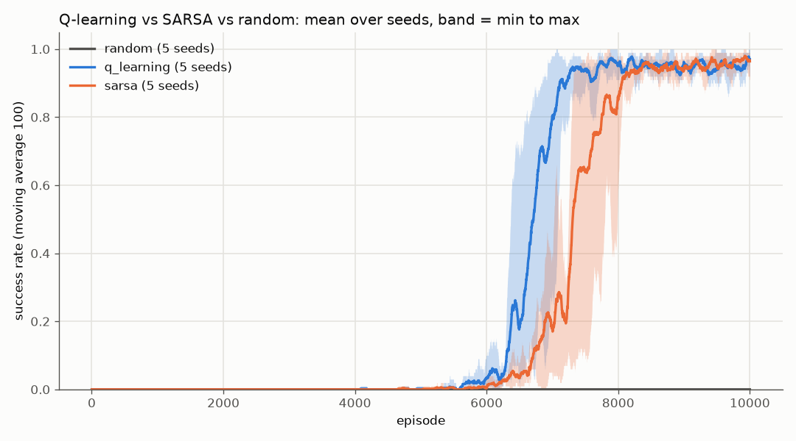
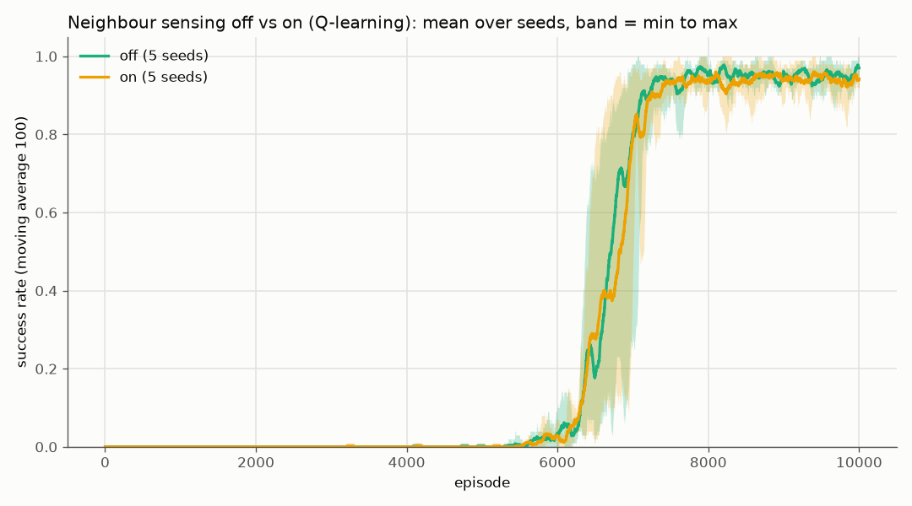
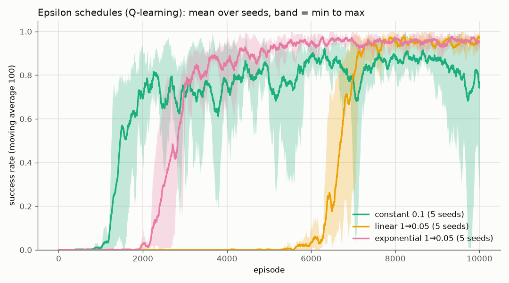

# Blob Quest

[](https://github.com/fani05/Blob-Quest/actions/workflows/ci.yml)
[](LICENSE)


A blob has to cross a foggy grid world to reach the goal. It can't see the map. All it knows is
its own state: where it is, roughly how much energy it has left, which boosters it has already
used, and whether a drain or speed effect is active. It learns which moves are good with
**tabular Q-learning or SARSA**, using only the rewards and penalties it collects over thousands
of episodes. A **random agent** that never learns serves as the baseline.

Everything runs in the terminal. Plots are saved as PNG files, and there is no GUI.

## Tiles

| Char | Tile   | Effect |
|------|--------|--------|
| `@`  | start  | spawn point |
| `G`  | goal   | success, episode ends |
| `#`  | wall   | blocks movement |
| `T`  | trap   | -10 energy |
| `X`  | pit    | death, episode ends |
| `D`  | drain  | the next 5 steps cost 2 energy |
| `E`  | energy | +15 energy, single use per episode |
| `S`  | speed  | the next 3 moves travel 2 cells, single use per episode |
| `R`  | reset  | teleport back to the start |

Every step costs energy. At 0 energy the episode fails.

**Sensing mode** (`agent.sensing: true`, off by default) adds the tiles of the four neighbouring
cells to the state, but only for cells the blob has visited in earlier episodes; everything else
is fog. Since the position already fixes which tile each neighbour is, the Q-table only needs one
"known" bit per enterable neighbour (at most 16x the plain table, 379,040 states on the default
map instead of 36,000).

## Quick start

```bash
python -m venv .venv
.venv\Scripts\activate          # Windows  (source .venv/bin/activate on Linux/macOS)
pip install -e ".[dev]"

blobquest show-map                                  # print the generated map
blobquest train                                     # Q-learning, configs/default.yaml
blobquest train --config configs/sarsa.yaml         # SARSA
blobquest train --config configs/handmade.yaml      # hand-drawn map with diagonals
blobquest train --config configs/hard.yaml          # 20x20, more traps and pits, less energy
blobquest train --episodes 20000 --seed 1 --map-seed 3
blobquest evaluate runs/<run-folder> --episodes 5   # replay a saved greedy policy
blobquest replay runs/<run-folder> --delay 0.3      # watch one greedy episode step by step
blobquest compare --config configs/default.yaml --seeds 5   # random vs q_learning vs sarsa

python experiments/run_experiments.py --jobs 4 --update-readme   # the experiments below

pytest
ruff check src tests experiments
```

Each run writes `runs/<name>_<timestamp>/` containing `config.yaml`, `world.txt`,
`q_table.npz`, `episodes.csv`, `evaluations.csv`, `mistakes.csv`, `summary.yaml`, `visits.npy`,
`explored.npy` and `plots/`. The plots are rewards, outcomes, steps, schedules, evaluation,
policy map, value map, visits and mistakes.

`compare` trains every algorithm on the same map with seeds `training.seed .. training.seed + N - 1`,
prints a mean ± std table and writes `runs/<name>_compare_<timestamp>/` with `comparison.png`,
`comparison.csv`, `config.yaml` and `world.txt`.

## Fog of war

At the end of training, `blobquest train` prints the map as the blob knows it next to the real one.
Cells it never entered during training are `?`, and `*` marks the final greedy route. Walls are
never entered, so they always stay hidden. This is the output of
`blobquest train --config configs/handmade.yaml` (6000 episodes, diagonal moves; the greedy run
reached the goal in 17 steps):

```text
What the blob saw      True map
@ . . ? . . . . . .    @ . . # . . . . . .
* ? . ? . X X . E .    . # . # . X X . E .
* ? . . . T . . . .    . # . . . T . . . .
* ? ? ? ? . ? ? X .    . # # # # . # # X .
. * . D . . ? . . .    . . . D . . # . . .
X X * ? S . ? . R .    X X . # S . # . R .
. * . ? . . T . . .    . . . # . . T . . .
. R * ? ? ? ? . ? .    . R . # # # # . # .
. . * D * * . * X X    . . . D . . . . X X
. X . * T ? E . * G    . X . . T # E . . G
? never visited during training
```

## Experiments

[`experiments/run_experiments.py`](experiments/run_experiments.py) trains every variant below with
5 seeds on the same map (`configs/default.yaml` unless `--config` says otherwise). It writes
[`docs/results.md`](docs/results.md) and the plots in `docs/images/`, and with `--update-readme` it
fills in the tables in this section. Each plot shows the training success rate: the line is the
mean over seeds and the band runs from the worst seed to the best.

<!-- results:settings:start -->
Config `configs/default.yaml`, 15x15 map (map seed 7), 10000 episodes per run, seeds [42, 43, 44, 45, 46]. Cells are mean ± std across seeds; train metrics cover the last 100 episodes, greedy success is the final evaluation (5 greedy episodes).
<!-- results:settings:end -->

### Q-learning vs SARSA vs random

SARSA trains without replay memory, as in `configs/sarsa.yaml`.

<!-- results:algorithms:start -->
| algorithm | greedy success | train success | reward | steps to goal | repeat mistakes |
|:---|---:|---:|---:|---:|---:|
| random | 0.0% ± 0.0% | 0.0% ± 0.0% | -122.2 ± 0.8 | - | 99.0% ± 0.1% |
| q_learning | 100.0% ± 0.0% | 97.0% ± 2.8% | 53.1 ± 5.0 | 31.9 ± 4.0 | 97.3% ± 0.1% |
| sarsa | 100.0% ± 0.0% | 96.4% ± 3.1% | 46.9 ± 3.4 | 35.9 ± 0.8 | 97.5% ± 0.1% |
<!-- results:algorithms:end -->



### Sensing off vs on (Q-learning)

<!-- results:sensing:start -->
| sensing | greedy success | train success | reward | steps to goal | repeat mistakes |
|:---|---:|---:|---:|---:|---:|
| off | 100.0% ± 0.0% | 97.0% ± 2.8% | 53.1 ± 5.0 | 31.9 ± 4.0 | 97.3% ± 0.1% |
| on | 100.0% ± 0.0% | 94.2% ± 2.1% | 48.8 ± 4.3 | 31.8 ± 5.2 | 97.3% ± 0.1% |
<!-- results:sensing:end -->



### Epsilon schedules (Q-learning)

<!-- results:epsilon:start -->
| epsilon schedule | greedy success | train success | reward | steps to goal | repeat mistakes |
|:---|---:|---:|---:|---:|---:|
| constant 0.1 | 80.0% ± 40.0% | 74.4% ± 24.4% | 15.8 ± 40.3 | 31.9 ± 3.4 | 94.0% ± 1.1% |
| linear 1→0.05 | 100.0% ± 0.0% | 97.0% ± 2.8% | 53.1 ± 5.0 | 31.9 ± 4.0 | 97.3% ± 0.1% |
| exponential 1→0.05 | 100.0% ± 0.0% | 95.2% ± 1.8% | 53.5 ± 3.3 | 28.4 ± 2.7 | 94.1% ± 0.3% |
<!-- results:epsilon:end -->



**Columns:** *greedy success* is the share of greedy (epsilon = 0) episodes that reach the goal at
the final evaluation. *Train success* and *reward* cover the last 100 training episodes.
*Steps to goal* only counts successful episodes. *Repeat mistakes* is the share of deaths on a cell
where the blob had already died before.

## Layout

```
src/blobquest/
  config.py       frozen, validated dataclasses (every tunable number)
  tiles.py        Tile enum and text characters
  world.py        hidden map: seeded generation, layout parsing, solvability check
  state.py        State tuple and integer encoder for the Q-table (with optional sensing)
  env.py          dynamics: energy, tiles, speed, drain, termination
  agents/         TabularAgent base, Q-learning, SARSA, random baseline
  schedules.py    epsilon / alpha schedules
  memory.py       replay memory that rehearses mistakes more often
  trainer.py      training loop, evaluation, greedy rollouts and step-by-step replays
  mistakes.py     failed-episode log, repeated-mistake rate, deadliest cells
  compare.py      train several variants on one map and seeds, results tables
  metrics.py      per-episode records and summaries
  plots.py        PNG plots (matplotlib Agg, no pyplot)
  render.py       ASCII map, path, policy, fog-of-war and replay frames
  persistence.py  save and load runs
  cli.py          `blobquest train | evaluate | replay | compare | show-map`
configs/          default.yaml, sarsa.yaml, handmade.yaml, hard.yaml
experiments/      run_experiments.py (writes docs/results.md and docs/images/)
docs/             experiment results and plots
tests/            pytest suite
.github/          CI: ruff + pytest on Python 3.12 and 3.13
```

## License

[MIT](LICENSE) © 2026 Nica Fabian
