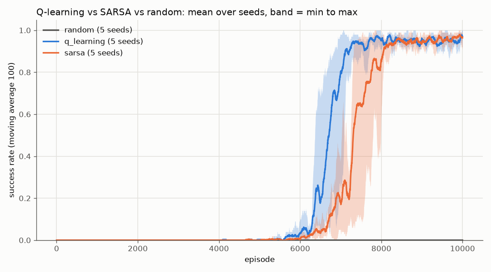
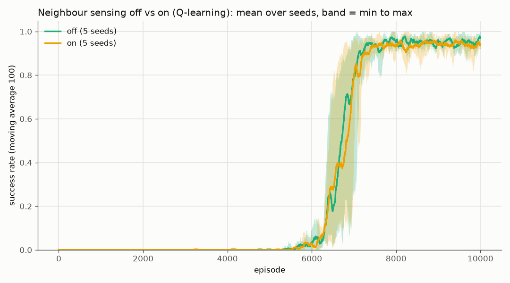
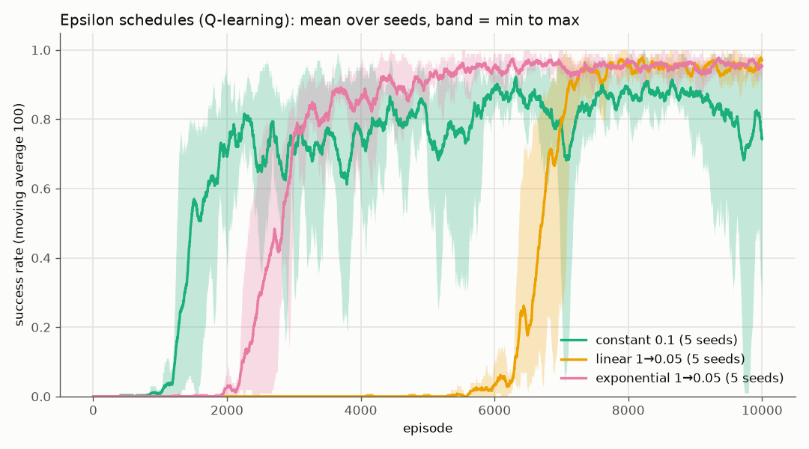

# Blob Quest experiment results

Generated by `experiments/run_experiments.py`.

Config `configs/default.yaml`, 15x15 map (map seed 7), 10000 episodes per run, seeds [42, 43, 44, 45, 46]. Cells are mean ± std across seeds; train metrics cover the last 100 episodes, greedy success is the final evaluation (5 greedy episodes).

#### Q-learning vs SARSA vs random

| algorithm | greedy success | train success | reward | steps to goal | repeat mistakes |
|:---|---:|---:|---:|---:|---:|
| random | 0.0% ± 0.0% | 0.0% ± 0.0% | -122.2 ± 0.8 | - | 99.0% ± 0.1% |
| q_learning | 100.0% ± 0.0% | 97.0% ± 2.8% | 53.1 ± 5.0 | 31.9 ± 4.0 | 97.3% ± 0.1% |
| sarsa | 100.0% ± 0.0% | 96.4% ± 3.1% | 46.9 ± 3.4 | 35.9 ± 0.8 | 97.5% ± 0.1% |

#### Neighbour sensing off vs on (Q-learning)

| sensing | greedy success | train success | reward | steps to goal | repeat mistakes |
|:---|---:|---:|---:|---:|---:|
| off | 100.0% ± 0.0% | 97.0% ± 2.8% | 53.1 ± 5.0 | 31.9 ± 4.0 | 97.3% ± 0.1% |
| on | 100.0% ± 0.0% | 94.2% ± 2.1% | 48.8 ± 4.3 | 31.8 ± 5.2 | 97.3% ± 0.1% |

#### Epsilon schedules (Q-learning)

| epsilon schedule | greedy success | train success | reward | steps to goal | repeat mistakes |
|:---|---:|---:|---:|---:|---:|
| constant 0.1 | 80.0% ± 40.0% | 74.4% ± 24.4% | 15.8 ± 40.3 | 31.9 ± 3.4 | 94.0% ± 1.1% |
| linear 1→0.05 | 100.0% ± 0.0% | 97.0% ± 2.8% | 53.1 ± 5.0 | 31.9 ± 4.0 | 97.3% ± 0.1% |
| exponential 1→0.05 | 100.0% ± 0.0% | 95.2% ± 1.8% | 53.5 ± 3.3 | 28.4 ± 2.7 | 94.1% ± 0.3% |

